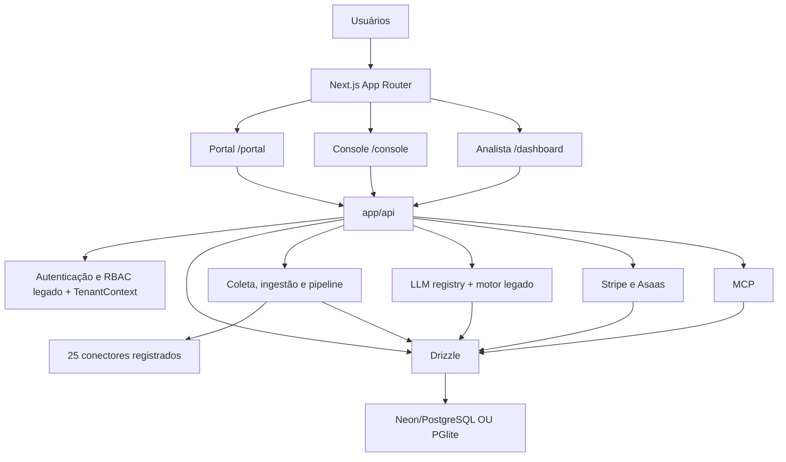

# VIGIAELUS / VIGIAPLUS — Inventário técnico verificado

**Data:** 2026-11-09 · **Fonte:** GitHub `OARANHA/vigiaplus`, `main`, commit `d2d9eafe7667b21a4badc14a3161501f5c72513d` · **Natureza:** auditoria estática de código. Não é atestado de implantação, disponibilidade ou validação de produção.

> Documento de ESTADO ATUAL, diferente dos documentos de proposta `vigiaplus-arquitetura.md`, `vigiaplus-roadmap.md` e `remodelagem.md`. Não interpretar a presença de um módulo como integração homologada. Senhas e segredos não são reproduzidos.

## 1. Visão geral

Produto de monitoramento de reputação, escuta de mídia, análise, gestão de crise e entrega de informações a clientes, derivado do Radar Intelligence (`OARANHA/crises`), preservando o modo analista e adicionando o núcleo B2B multi-tenant.

**Três superfícies:** `/portal` (cliente), `/console` (proprietário/admin) e `/dashboard` (analista); `app/page.tsx` encaminha conforme `globalRole`. A aplicação do Radar preserva diversas páginas analíticas (`/listening`, `/query`, `/insights/*`, `/report`, `/import`, `/studio`, etc.). `app/portal/page.tsx` apresenta Panorama, Crises, Relatórios e Conta. `app/console/page.tsx` lista áreas administrativas, mas parte dos botões é demonstrativa e alguns KPIs são literais fixos.

**Inventário da árvore Git:** 560 arquivos; 73 `app/api/**/route.ts`; 54 tabelas `pgTable` no Drizzle; 25 conectores no registro `lib/connectors/index.ts`. Contagem de arquivos, tabelas e rotas não equivale a cobertura funcional.

## 2. Stack, organização e dependências

- Aplicação: Next.js 16.2.10 (App Router), React 19.2.4, TypeScript, Tailwind CSS 4, Recharts, Three.js.
- API de dados: Drizzle ORM 0.45.2, Postgres via `@neondatabase/serverless` quando `DATABASE_URL` é definido; caso contrário, PGlite embarcado (`.data/pglite`).
- Arquivos: `app/` (páginas e rotas), `components/` (UI), `lib/` (domínio, autorização, ingestão, integrações e IA), `lib/db/` (schema, bootstrap/seeds), `migrations/` e `scripts/migrate.ts` (migrações versionadas), `scripts/workers/` (notificações/cobrança), `deploy/` (container e proxy), `tests/` (testes), `docs/` (propostas e evidências).
- IA: Anthropic SDK e adaptador legado `lib/ai-provider.ts`; cadastro de provedores compatíveis OpenAI em `lib/tenant/llm-registry.ts` e ponte `lib/llm-bridge.ts`. Implementações coexistem.
- Exportações: PDF (PDFKit), DOCX, XLSX (ExcelJS), PPTX (PptxGenJS). MCP: `@modelcontextprotocol/sdk`.

### Diagrama lógico (código presente, não SLA de produção)



### Módulos-chave

| Domínio | Arquivos de referência | Estado |
|---|---|---|
| Sessão e proteção | `proxy.ts`, `lib/session.ts`, `lib/session-auth.ts`, `lib/api-guard.ts` | Cookie HMAC + revisão da versão no DB nos guards; coexistência com autorização antiga |
| Tenants, papéis, planos | `lib/tenant/{context,rbac,entitlements,catalog,scope}.ts` | Implementação com RLS opcional; não certificada em todas as rotas |
| Persistência | `lib/db/{index,schema,vigia-seed}.ts`; `migrations/*.sql` | Bootstrap DDL em runtime + runner de migrações; requer reconciliação |
| Coleta de piloto | `lib/vigia/{core,pilot,collection}.ts` e `app/api/vigia/*` | Coleta manual, histórico por fonte, deduplicação |
| Coleta geral | `lib/connectors/*`, `lib/ingest.ts`, `lib/pipeline.ts` | Conectores de operação e quota variados; não pressupor funcionamento de cada API |
| IA | `lib/ai-provider.ts`, `lib/llm-bridge.ts`, `lib/tenant/llm-registry.ts` | Registry + legado; roteamento por tenant/finalidade não garantido na ponte |
| Faturamento | `lib/billing/*`, `app/api/billing/*`, `app/api/webhooks/*` | Implementado em código; Asaas divergente da API oficial |
| Notificações | `lib/notifications/*`, `scripts/workers/notify.ts` | Regras/canais/entregas; execução externa não validada |
| Visualização | `app/portal`, `app/console`, `app/dashboard`, `components/` | UI incompleta em console; dados demonstrativos no portal |

## 3. Banco de dados e domínio

A **fonte declarativa** é `lib/db/schema.ts` com 54 tabelas. Principais famílias:

- Identidade e contrato: `users`, `tenants`, `memberships`, `plans`, `plan_features`, `tenant_features`, `subscriptions`, `invoices`, `payment_events`, `invitations`.
- Reputação e crise: `reputation_targets`, `incidents`, `incident_actions`, `projects`, `mentions`, `alerts`, `briefs`, `stories`, `trends`, `narratives`, `timeline_events`, `benchmark_entities`.
- Coleta e rastreabilidade CRF-RS: `collection_runs`, `collection_run_sources`, `mention_entities`, `mention_discoveries`.
- IA/segurança/notificações: `llm_providers`, `llm_routes`, `llm_usage`, `mcp_tokens`, `audit_events`, `notification_channels`, `alert_rules`, `notification_deliveries`.
- Conteúdo analítico e extensões: `review_sources`, `reviews`, `sport_sources`, `sport_matches`, `stock_prices`, `search_interest`, `wiki_pages`, `wiki_edits`, `import_files`, `import_rows`, `custom_reports`, `periodic_reports`, `metric_points`, `studio_charts`, `fact_checks`, `clinical_trials` e outras do schema.

**Relacionamentos essenciais:** `memberships.user_id -> users`; `memberships.tenant_id -> tenants`; `projects.tenant_id -> tenants` (coluna adicionada no bootstrap); `mentions.project_id -> projects`; `incidents.tenant_id -> tenants`; `invoices.tenant_id -> tenants`. Diversas entidades legadas dependem do vínculo indireto de projeto ao tenant. As políticas `migrations/00002_rls.sql` estão condicionadas a um parâmetro de sessão opt-in e não asseguram isolamento quando ele não é definido. Ver auditoria adjacente.

**Estratégia atual:** `getDb()` inicializa o driver, executa `ensureSchema()` com DDL aditivo, seeds originais e `seedVigiaPlus()`. `scripts/migrate.ts` implementa `schema_migrations`/checksum para `00001_billing.sql` e `00002_rls.sql`. O runner não está no `CMD` do Dockerfile nem no workflow CI: controlar aplicação de migrações no provisionamento, antes de expor tráfego.

## 4. APIs — mapa por domínio

Há **73 arquivos de rota**. Esta relação documenta rotas presentes, não todos os métodos/contratos de entrada. Para cada cliente de API, validar verbo, schema, erros e permissões no respectivo `route.ts`.

| Grupo | Rotas principais | Controle |
|---|---|---|
| Sessão/usuário | `/api/auth`, `/api/me/permissions`, `/api/me/preferences` | Cookie de sessão; versão revogável |
| Portal cliente | `/api/app/summary`, `/api/app/plan`, `/api/app/brand` | `TenantContext`, RBAC e feature gates |
| Console | `/api/console/tenants`, `/api/console/tenants/[id]/features`, `/api/console/billing`, `/api/console/llm-providers`, `/api/console/llm-providers/[id]/test`, `/api/console/llm-status` | `requireOwner` |
| Cobrança | `/api/billing/checkout`, `/api/billing/invoices`, `/api/webhooks/stripe`, `/api/webhooks/pix` | Sessão do tenant no checkout; webhook sem cookie com autenticação específica |
| Coleta e análise | `/api/vigia/pilot`, `/api/vigia/collect`, `/api/refresh`, `/api/ask`, `/api/brief`, `/api/insights/clusters`, `/api/insights/causal`, `/api/compare` | Guards herdados; conferir tenant de ponta a ponta |
| Importação/exportação | `/api/import/{preview,files,agent,normalized,spotcheck,analyze,audit}`, `/api/export/{pdf,docx,pptx,xlsx,report,periodic}` | Verificar IDOR, limites e entitlements |
| Relatórios e mídia | `/api/report/*`, `/api/studio/*`, `/api/reviews/*`, `/api/wikipedia/*`, `/api/sport/*` | Rotas herdadas |
| MCP/cron | `/api/mcp`, `/api/cron/daily`, `/api/cron/reports` | Tokens específicos; não usar sessão como única defesa |
| Saúde | `GET /api/health` | Liveness público (não verifica DB nem dependências) |

## 5. Fluxos existentes (com limites explicitados)

1. **Login:** `POST /api/auth` -> consulta `users` -> compara hash -> cookie HMAC -> `/console`, `/dashboard` ou `/portal`. Revogação via `session_version`; bloqueio por tentativas/conta não é persistente.
2. **Portal:** sessão -> `TenantContext` a partir de `memberships` (ou seleção auditada do dono) -> entitlements -> `/api/app/summary`/plano -> gráficos, incidentes e faturas. Parte dos dados vem do seed/hardcode e deve ser marcada.
3. **Piloto CRF-RS:** projeto via `/api/vigia/pilot` -> coleta manual `/api/vigia/collect` -> fontes Google News/GDELT configuradas -> tabelas de execução, fontes, menções e dedupe -> `/vigia`. Instagram não está homologado no piloto; GDELT pode devolver HTTP 429.
4. **Pipeline geral:** `/api/cron/daily` com `CRON_SECRET` -> `runPipeline` -> conectores -> enriquecimento/IA -> relatórios/alertas -> retenção global 90 dias de menções não importadas. Automatização de 4 clientes/h com escalonamento independente não demonstrada.
5. **LLM:** owner cadastra um endpoint HTTPS/modelo/ENV-ref -> registry -> `callProvider` (quota/validação DNS) ou ponte de compatibilidade com motor legado. A ponte atual seleciona primeiro um registro GLOBAL e não implementa o roteamento desejado por tenant e finalidade em todos os caminhos.
6. **Cobrança:** cliente inicia checkout -> gateway Stripe/Asaas -> `POST /api/webhooks/*` -> normalização/evento -> atualiza fatura/assinatura -> entitlements. Asaas tem incompatibilidades e não deve receber cobranças reais antes da correção.
7. **MCP:** `POST /api/mcp` sem cookie, token global legado ou hash de token por tenant; servidor expõe ferramentas via Streamable HTTP. Verificar escopo de cada tool e limite distribuído.

## 6. Configuração e execução

**Desenvolvimento local (Windows PowerShell):**

```powershell
git clone https://github.com/OARANHA/vigiaplus.git D:\VIGIAPLUS
cd D:\VIGIAPLUS
Copy-Item .env.example .env.local
npm ci
npm run dev
# localhost:3000 por padrão; outra porta: npm run dev -- -p 3100
```

**Testes estáticos / aplicação de migração:**
```powershell
npx eslint .
npx tsc --noEmit
npm test
npm run build
npm run migrate:check
# em banco descartável com backup e controle de versão:
npm run migrate
```

**Docker:** preencher `deploy/.env` e executar `docker compose -f deploy/docker-compose.yml --env-file deploy/.env up -d --build` na raiz (ou `cd deploy; docker compose up -d --build`). Configurar `APP_DOMAIN`, `ACME_EMAIL` e DNS, certificados e volumes. Os comandos não foram executados nesta auditoria. A montagem de volume PGlite exige confirmar ownership gravável pelo usuário `nextjs` do container; não assumir que o volume está operacional. Para uso multi-tenant real, priorizar Postgres gerenciado, backup/restauração comprovados e papel sem `BYPASSRLS`.

**Variáveis principais (nomes; nunca guardar valores):**
- Base/ambiente: `DATABASE_URL`, `PGLITE_DIR`, `SESSION_SECRET`, `APP_URL`, `APP_DOMAIN`, `ACME_EMAIL`, `CRON_SECRET`, `DEMO_MODE`.
- Provisionamento: `ADMIN_EMAIL`, `ADMIN_PASSWORD`, `ADMIN_NAME`. **Não iniciar produção com defaults ou seed de usuários com senha fixa.**
- Identidade visual: `NEXT_PUBLIC_BRAND_NAME`, `NEXT_PUBLIC_BRAND_BYLINE`.
- IA: `ANTHROPIC_API_KEY`, `API_BUDGET_USD`, `AZURE_OPENAI_API_KEY`, `AZURE_OPENAI_ENDPOINT`; provedores adicionais pelo LLM Registry usando `ENV:<NOME>`; flags `VIGIA_ALLOW_INSECURE_LLM` e `VIGIA_ALLOW_PRIVATE_LLM` não devem ser habilitadas em produção.
- Fontes: `YOUTUBE_API_KEY`, `REDDIT_CLIENT_ID`, `REDDIT_CLIENT_SECRET`, `X_BEARER_TOKEN`, `META_ACCESS_TOKEN`, `INSTAGRAM_USER_ID`, `FACEBOOK_PAGE_ID`, `TIKTOK_CLIENT_KEY`, `TIKTOK_CLIENT_SECRET`, `LINKEDIN_ACCESS_TOKEN`, `LINKEDIN_ORG_ID`, `NEWSAPI_KEY`, `NEWSDATA_API_KEY`, `TALKWALKER_ACCESS_TOKEN`, `TALKWALKER_DAILY_CREDITS`, `PODCASTINDEX_API_KEY`, `PODCASTINDEX_API_SECRET`, `STACK_EXCHANGE_KEY`, `GITHUB_TOKEN`, `DISCORD_BOT_TOKEN`, `DISCORD_CHANNEL_IDS`, `TAVILY_API_KEY`, `GOOGLE_FACTCHECK_API_KEY`, `GOOGLE_PLACES_API_KEY`, `YELP_API_KEY`, `FOOTBALL_DATA_API_KEY`, `ALPHA_VANTAGE_API_KEY`.
- Notificações: `TELEGRAM_BOT_TOKEN`, `TELEGRAM_CHAT_ID`.
- MCP: `RADAR_MCP_TOKEN` (legado global; preferir tokens escopados).
- Pagamentos: `STRIPE_SECRET_KEY`, `STRIPE_WEBHOOK_SECRET`, `ASAAS_API_KEY`, `ASAAS_BASE_URL`, `PIX_WEBHOOK_SECRET` (a implementação HMAC diverge do cabeçalho oficial Asaas).
- `.env.example` duplica a declaração `CRON_SECRET`; `deploy/docker-compose.yml` não transmite todas as chaves de fontes e IA explicitamente: revisar contrato de configuração e secret manager.

## 7. CI e execução verificada

`.github/workflows/ci.yml` faz `npm ci`, ESLint, `tsc --noEmit`, testes `tests/*.test.ts` e `npm run build` em push/PR para `main`. **CI do SHA auditado:** run [42541351420](https://github.com/OARANHA/vigiaplus/actions/runs/42541351420) concluído com sucesso em 2026-11-09. **Não comprovados:** análise de dependências/segredos, E2E ponta a ponta no CI, migração aplicada em staging, certificação de webhook com PSP sandbox, teste de restore, disponibilidade de servidor, custo real de IA, GDELT/Instagram reais e carga multi-tenant.

## 8. Arquivos que complementam este inventário

- [Auditoria e backlog deste snapshot](./auditoria-critica-2026-11-09.md).
- [Arquitetura alvo (proposta)](./vigiaplus-arquitetura.md).
- [Roadmap alvo (documento histórico)](./vigiaplus-roadmap.md).
- [Remodelagem e contrato de valor do portal](./remodelagem.md).
- [Piloto CRF-RS](../vigiaelus-crfrs.md).
- [Deploy](../../DEPLOY.md).

**Limite de acesso:** código auditado via GitHub. Não foi realizada leitura, clone, build ou teste do diretório Windows `D:\VIGIAPLUS` neste ambiente.
